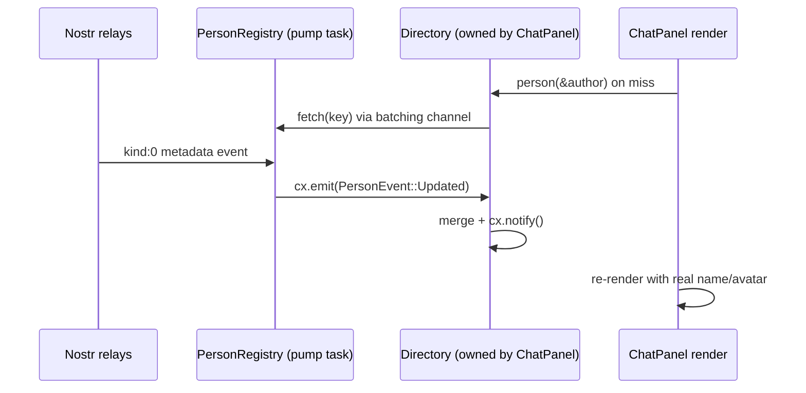

# Per-view person directories

Refactor plan for how user metadata is stored and observed. Today a single global
`PersonRegistry` owns every profile and every render path reads through it. The
proposal binds metadata to the panel/screen that renders it, and shrinks the
global to a thin event pump.

## Goal

- A panel that renders profiles owns its metadata store (`Entity<Directory>`),
  populated from the set of public keys that panel actually displays.
- Re-renders are scoped: a metadata update only re-renders panels observing the
  directory it landed in, not every view that ever read a global.
- Cache lifetime follows view lifetime: directories drop with their panel, so
  the global map never grows unbounded.
- The global registry becomes thin: nostr notification pump, batched request
  coordinator, and the signed-in user's own profile/emojis. No global person map.

## Current behavior, and two latent bugs

Flow today: render calls `PersonRegistry::global(cx).read(cx).get(&pk, cx)` →
registry returns a cloned `Person` from its map, or a default placeholder and
pushes the key to a batching channel → relay events arrive via
`handle_notifications` → `insert()` updates or creates `Entity<Person>`.

Bug 1 — updates never reach the UI reliably. `get()` returns a cloned value, so
views observe the *registry*, never the `Entity<Person>` handles. But the
mutation paths (`insert`, `set_announcement`, `set_messaging_relays`,
`set_emojis_for`) only call `cx.notify()` on the **person entity** in the
existing-person branch, and `insert` notifies nothing for new persons. So live
metadata arriving for an already-rendered placeholder does not trigger a
re-render; the UI is patched by unrelated renders (messages arriving, etc.).
Only `bulk_insert` (startup DB load) notifies the registry.

Bug 2 — the startup DB load is unscoped. `load()` queries
`Filter::new().kind(Metadata).limit(200)` — any 200 metadata events in the local
database, not the people the app will show.

Both problems disappear when the store is bound to the view that reads it.

## Proposed architecture

```
┌──────────────┐  notifications   ┌─────────────────────────────┐
│ nostr Client │─────────────────▶│ PersonRegistry (thin, global)│
└──────────────┘                  │  • pump → emits PersonEvent  │
                                  │  • fetch(keys): dedupe +     │
                                  │    batched relay subscribe   │
                                  │  • current user's profile +  │
                                  │    emojis (send paths)       │
                                  └──────────┬──────────────────┘
                            PersonEvent      │  fetch(keys)
                    ┌────────────────────────┼───────────────────────┐
                    ▼                        ▼                       ▼
             Entity<Directory>        Entity<Directory>       Entity<Directory>
             (ChatPanel)              (Sidebar)               (ContactListPanel)
                    ▲                        ▲                       ▲
                    └───────── panels read during render ────────────┘
```

New `Directory` type in `crates/person`:

```rust
pub struct Directory {
    persons: HashMap<PublicKey, Person>,   // values, not entities
    pending: HashSet<PublicKey>,           // on-miss dedupe, replaces global `seen`
    tasks: SmallVec<[Task<()>; 2]>,
    _subscriptions: SmallVec<[Subscription; 1]>, // PersonRegistry events
}

impl Directory {
    pub fn new(cx: &mut App) -> Entity<Self>;
    /// Diff against known keys, load missing from the local DB scoped by
    /// author, request the rest through the registry coordinator.
    pub fn track(&mut self, keys: impl IntoIterator<Item = PublicKey>, cx: &mut Context<Self>);
    /// Hit returns the stored person, miss returns a default placeholder and
    /// requests it (same ergonomics as `PersonRegistry::get` today).
    pub fn person(&self, public_key: &PublicKey, cx: &App) -> Person;
}
```

- Panels create a directory and call `track(authors)` whenever their key set
  changes (room event appends messages, contacts load, members load). Render
  swaps `PersonRegistry::global(cx).read(cx).get(...)` for
  `self.directory.read(cx).person(...)`. Reading the directory during render is
  enough for GPUI to re-render the panel when the directory notifies.
- Store `Person` values, not `Entity<Person>`: nothing observes person entities
  today, and a panel re-renders wholesale anyway. One `cx.notify()` per
  incoming batch. Per-person entities can come later if fine-grained
  invalidation is ever profiled as needed.
- The registry emits `PersonEvent::Updated(Person)` for every metadata /
  announcement / relay-list / emoji event it pumps. Directories merge events
  for keys they track and notify.
- `fetch(keys)` keeps the existing batching channel (20-key batches,
  `TIMEOUT` timeout) plus an in-flight set so two panels tracking the same
  person trigger one relay subscription. Results flow back through the pump,
  so the coordinator stays stateless beyond in-flight tracking.

### Event flow

How a relay event becomes a panel re-render:

1. The registry pump converts nostr notifications into events. `cx.emit` is
   synchronous — subscribers run during the registry's update:

```rust
#[derive(Debug, Clone)]
pub enum PersonEvent {
    Updated(Person), // metadata, emojis, announcement, or relays merged in
}

impl EventEmitter<PersonEvent> for PersonRegistry {}

// inside the registry's foreground loop (Context<PersonRegistry>):
match dispatch {
    Dispatch::Person(person) => cx.emit(PersonEvent::Updated(person)),
    // announcements, relay lists, emojis merge into `person` upstream
    ...
}
```

2. Each directory subscribes at creation. The subscription lives in a field,
   so it is dropped when the panel (and its directory) is dropped:

```rust
impl Directory {
    pub fn new(cx: &mut App) -> Entity<Self> {
        let registry = PersonRegistry::global(cx);
        let subscription = cx.subscribe(&registry, |this, _registry, event, cx| {
            this.handle_event(event.clone(), cx);
        });

        cx.new(|_| Self {
            persons: HashMap::new(),
            pending: HashSet::new(),
            _subscriptions: smallvec![subscription],
        })
    }

    fn handle_event(&mut self, event: PersonEvent, cx: &mut Context<Self>) {
        let PersonEvent::Updated(person) = event;
        let public_key = person.public_key();

        // Only react to keys this panel actually renders
        if self.persons.contains_key(&public_key) || self.pending.remove(&public_key) {
            self.persons.insert(public_key, person);
            cx.notify();
        }
    }
}
```

   The `pending` check is the on-miss path: when `person()` was called during
   render for an unknown key, it returned a placeholder, queued a fetch, and
   marked the key pending. When the event lands, the key is accepted, merged,
   and the directory notifies.

3. The panel re-renders because it read the directory during render. GPUI
   tracks entities read while rendering a view, so
   `self.directory.read(cx).person(...)` registers the dependency implicitly.
   When the directory calls `cx.notify()`, GPUI re-renders exactly the views
   that read it — the chat panel, not the sidebar, not other rooms. Explicit
   wiring is only needed if the panel must run *logic* on change (e.g. touch
   `ListState` item heights): `cx.observe(&directory, |_, _, cx| cx.notify()).detach()`.



This is what fixes bug 1: today the same incoming metadata calls `cx.notify()`
on the `Entity<Person>`, an entity nobody observes, and the update dies there.
In the new design the notify lands on the directory, which the view observed
when it read it during render.

### Send paths

`emoji_tags` / `current_emojis` are used when *signing* events
(`chat::Room::rumor`, `nip29::Group::send_message/send_reaction`) and by emoji
menus, regardless of which panel is visible. These keep reading the registry,
which retains the signed-in user's own profile and emoji list. The API stays
`PersonRegistry::current_emojis(cx)` / `::emoji_tags(content, cx)` so call
sites don't change. The `Kind::ContactList` metadata warm-up moves out of the
pump — panels fetch the keys they display.

### Why this fits GPUI

Observation becomes exact: a panel re-renders when its own directory changes.
This is also what makes render caching (`cached_view`-style reuse) correct —
which additionally requires `Person`'s `PartialEq` to compare *content*
(metadata, emojis, announcement, relays), not just the public key as it does
today, otherwise a cached render won't invalidate when a profile actually
changes.

## Migration

Each phase compiles and ships independently.

1. **Events + notify fix (small).** Add `EventEmitter<PersonEvent>` to
   `PersonRegistry`, emit from every mutation path, and make `insert` notify
   the registry for new persons (fixes bug 1 for the current design too). No
   call site changes.
2. **Add `Directory` (medium).** New type per the sketch above, subscribing to
   registry events and fetching via the coordinator. Unit-testable in
   `TestAppContext` by feeding events directly.
3. **Convert call sites (bulk, mechanical).** One panel/screen at a time:
   - `chat_ui::ChatPanel` — directory per panel, `track` in the room-event
     handler; pass the directory into `chat_ui::text::rendered_text` instead of
     `Entity<PersonRegistry>`.
   - `nip29_ui` — `message::render`, `render_activity`, `replies`,
     `GroupPanel::render_row` / `render_reply_target` take `&Entity<Directory>`
     as a parameter; the panel owns the directory.
   - `workspace` sidebar — one directory for the sidebar (`header::render_user`,
     `rows::render_rows`, `group_view::member_row`).
   - `workspace` dialogs — per-dialog directories: `contact_list.rs`,
     `new_chat.rs`, `profile.rs`, `screening.rs`. They drop with the dialog.
   - `chat::Room` render helpers (`display_member`, `merged_name`,
     `conversation_tags`) — the room owns a directory or receives names from
     the panel; send paths keep registry emoji helpers.
   - `nip4e::DeviceRegistry::notification` — one-off name lookup for a
     notification; give it a small directory or fetch-once (open question).
4. **Slim the registry (small).** Delete the global person map, `seen`,
   `bulk_insert`, and unscoped `load()` (fixes bug 2). Keep pump, `fetch`,
   current-user profile/emojis. `person()`/`get()` on the registry goes away;
   directories are the only read path for rendering.

## Call site inventory

| File | Functions |
| --- | --- |
| `crates/chat/src/room.rs` | `display_member`, `merged_name`, `conversation_tags`, `rumor`, `send` |
| `crates/chat_ui/src/lib.rs` | `profile`, `render_message`, `render_report`, `render_reply`, `render_emoji_menu` |
| `crates/chat_ui/src/text.rs` | `rendered_text` |
| `crates/nip29/src/group.rs` | `send_message`, `send_reaction` (emoji tags only) |
| `crates/nip29_ui/src/lib.rs` | `render_row`, `render_reply_target` |
| `crates/nip29_ui/src/message.rs` | `render`, `react_menu`, `render_activity`, `replies` |
| `crates/nip4e/src/lib.rs` | `DeviceRegistry::notification` |
| `crates/workspace/src/dialogs/new_chat.rs` | `filtered_contacts`, `render_contacts`, `render_members` |
| `crates/workspace/src/dialogs/profile.rs` | `profile`, `save` |
| `crates/workspace/src/dialogs/screening.rs` | `profile`, `mutual_contacts` |
| `crates/workspace/src/panels/contact_list.rs` | `render_list_items` |
| `crates/workspace/src/sidebar/group_view.rs` | `member_row` |
| `crates/workspace/src/sidebar/header.rs` | `render_user` |
| `crates/workspace/src/sidebar/rows.rs` | `render_rows` (Contact/Profile/Message) |

## Risks and open questions

- **Duplicate relay traffic across panels** is solved by the coordinator's
  in-flight set; if two panels want the same key after one subscription closed,
  a second fetch is acceptable (ExitOnEOSE, batched). Revisit only if relays
  complain.
- **True `PartialEq` for `Person`** is required for cache correctness; cheap to
  implement alongside the refactor.
- **`ProfileDialog::save`** reads old metadata through the registry; it should
  read the current user's profile from the registry's retained own-profile.
- **Naming**: `Directory` vs `Roster` vs `Persons`. Keeping the `Person` value
  type unchanged minimizes churn either way.
- **wasm32** target: directories use the same primitives (`instant`, flume,
  background spawns) the registry already uses — no new platform concerns.
